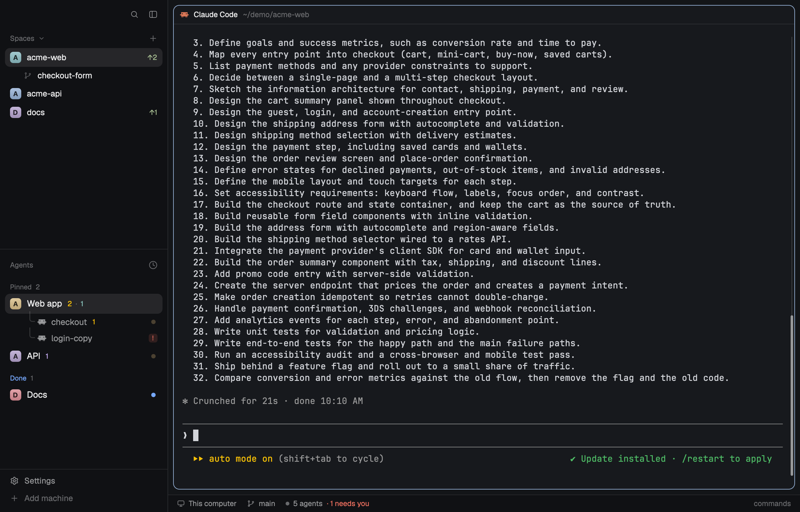

# Coordinator
### A higher-level agentic workflow for Claude Code and Herdr

Coordinator turns one coding-agent session into a manager for a body of
work. You give it a domain, such as a repo or a product area, and send it
requests as they come up. It writes a brief for each task and starts a
separate agent session to do it, in its own Git worktree and its own tab.
It watches those sessions, relays their questions to you, checks their
work, and cleans up when a task lands. You talk to one session, and up to
three others work in parallel.

It is a pair of skills for [Claude Code](https://claude.com/claude-code),
with Python scripts that drive [Herdr](https://herdr.dev). Herdr runs each
agent in a terminal that stays alive and shows them all in one app.

## How it works

- The coordinator is a Claude Code session you start with
  `/coordinator <domain or project>`. It owns one domain and keeps its state in a
  Markdown **backlog** file: what the domain covers, what you approved for
  good, what is open, and what is done. The backlog is what survives a
  restart.
- Delegates are the sessions it starts, one per task. Each gets a Git
  worktree, a brief that says what done looks like and where to stop, and a
  tab in the Herdr app listed under the coordinator. A delegate writes a
  `REPORT.md` when it stops.
- The watcher, `fleet_watch.py`, runs in the background and wakes the
  coordinator when a delegate finishes, asks something or gets stuck. It
  also wakes it when a pull request is merged, fails its checks or gets a
  review.
- The cap check keeps at most three delegates working at once, and can
  hold the number of open pull requests in a repo under a limit you set.
- Quiet delegates are ended after a day without a response, and resumed
  with the same session when something arrives for them.
- fleet-sweep, the second skill, removes finished worktrees, branches,
  tabs and stray processes. It refuses anything that would lose work and
  asks you about it.

The coordinator decides small, reversible things on its own and says what
it chose. It asks you when the answer changes what gets built, costs time
or money, reaches other people, or is a matter of taste. Questions arrive in
batches of at most five, each with its options and a recommendation.

## Requirements

| Tool | Why |
|---|---|
| [herdr-core](https://herdr.dev) (`hc`) | runs every agent in a terminal that outlives the app |
| [Herdr app](https://herdr.dev) (`herdr-app`) | shows each delegate in its own tab |
| [Claude Code](https://claude.com/claude-code) | runs the coordinator and its delegates |
| Python 3.9 or newer | runs the scripts, which use only the standard library |
| git | worktrees and branches |
| [gh](https://cli.github.com), signed in | pull request status, for domains with a GitHub repo |

Optional:

- [Codex](https://github.com/openai/codex) can take small, mechanical
  delegate tasks.
- The [inbox](https://github.com/petekp/inbox) mod for Claude Code collects
  every question in one pane. The scripts read its saved questions when it
  is installed.
- The coordinator sidebar is a Herdr layout in `herdr/`, described under
  [Herdr sidebar](#herdr-sidebar).

Tested on macOS with herdr-core 0.1.21, the Herdr app 0.1.15, Claude Code
2.1.325 and Codex 0.164.0.

Install herdr-core with:

```sh
curl -fsSL https://releases.herdr.dev/core/install.sh | sh
```

and download the Herdr app from [herdr.dev](https://herdr.dev).

## Install

To have an agent do it, paste this into Claude Code:

```
Set up the coordinator workflow by following https://raw.githubusercontent.com/petekp/coordinator/main/SETUP.md
```

It installs Herdr, these skills and the Inbox plugin, and offers Vignette
and the [Herdr sidebar](#herdr-sidebar), asking before each step. To install by hand:

```sh
git clone https://github.com/petekp/coordinator.git ~/src/coordinator
~/src/coordinator/install.sh
```

`install.sh` links both skills into `~/.claude/skills`, where Claude Code
finds them, and `~/.agents/skills`, where Codex finds them. It then checks
for the tools above. Keep the clone where it is: the links point into it.
To update, run `git pull` in the clone. At its first wake-up each day, the
fleet watcher checks whether the clone is behind its upstream, and the
coordinator tells you when it is. It never pulls by itself. To uninstall, run
`~/src/coordinator/install.sh --remove`, then delete the clone.

## Herdr sidebar



The `herdr/` folder holds an optional Herdr layout made for this workflow.
Its sidebar lists pinned coordinators first, in the order you drag them,
with each coordinator's delegates under it. The tab bar hides while a
coordinator's tab shows. Each agent gets a colored tile, and the inbox's
counts follow its name. The layout works without the coordinator or the
inbox, but the counts need the inbox.

The agent that follows SETUP.md offers the layout. To add it yourself, paste
this into an agent running inside the Herdr app:

```
Add the Herdr layout at https://github.com/petekp/coordinator/tree/main/herdr
```

The agent reads [herdr/RECIPE.md](herdr/RECIPE.md) and the layout's files,
then tells you what the mods run. It asks before it changes your keys or
your window.

## Configure

Every setting has a default, so you can skip this at first. To change one,
copy `config.example.json` to `~/.config/coordinator/config.json`, delete
the keys you don't need, and edit the rest. Its values are examples, not the
defaults. `COORDINATOR_CONFIG` can name another file.

| Key | What it sets | Default |
|---|---|---|
| `backlog_dir` | the folder for backlogs; briefs for domains without a repo go in its `briefs/` | `~/.config/coordinator/backlogs` |
| `state_dir` | ended delegates, the cap check's log and the watcher's state | `~/.local/state/coordinator` |
| `pr_limits` | most open pull requests from your GitHub account per repo, as `{"owner/repo": 30}` | none |
| `keep_running` | domains whose delegates are never ended for being quiet | none |
| `delegate_claude_args` | extra Claude Code arguments for every delegate, such as `["--autocompact", "300000"]` | none |
| `delegate_codex_overrides` | extra Codex `-c` settings for every Codex delegate | none |
| `inbox_store` | the inbox's saved state, needed only when more than one exists | found on its own |
| `backlog_limit_kb` | most kilobytes of a backlog outside its Done section, which the coordinator reads at each start; 40 KB is about 10,000 tokens | 40 |
| `done_limit_kb` | most kilobytes of a backlog's Done section | 20 |
| `trim_by_delegate_over_kb` | above this many kilobytes outside Done, about 37,000 tokens at 150, the coordinator has a delegate trim the backlog instead of reading it whole | 150 |
| `user_names` | regular expressions for your name, so the backlog check also finds your words quoted after it, as in `Sam said "..."` | none |
| `open_ask_patterns` | regular expressions, matched ignoring case, for other ways your backlogs mark an open ask | none |
| `check_for_updates` | whether the fleet watcher checks, at its first wake-up each day, that the clone is up to date with its upstream | `true` |

Put `backlog_dir` inside a Git repo if you want the coordinator to commit
each backlog change.

## First run

1. Open the Herdr app and a terminal tab in it.
2. Start Claude Code in the repo you want coordinated, and run
   `/coordinator <domain>`, for example `/coordinator web-app`.
3. The coordinator asks what the domain covers, creates its backlog, and
   reports what it found.
4. Send it a request. For anything bigger than a few files it starts a
   delegate in a new tab and tells you the tab's name.

Ask "where are we" at any time for a status table of delegates, pull
requests and open questions.

To start a coordinator for another domain in its own tab:

```sh
~/.claude/skills/coordinator/scripts/coordinator_restart.py start <domain> --cwd <repo> --space <space id>
```

The space id comes from `herdr-app ls`.

## Scripts

Each script's `--help` covers it in full.

| Script | What it does |
|---|---|
| `delegate_start.py` | starts a delegate, or resumes one whose terminal is gone |
| `delegate_cap.py` | allows or refuses a new delegate, and sends a message to one when allowed |
| `fleet_watch.py` | waits until something in the fleet needs the coordinator |
| `fleet_status.py` | prints the fleet's state, grouped by who acts next; with `--resume`, also the backlog sections to read again and whether the watcher runs |
| `backlog_check.py` | prints a backlog's size, and lists what a trim dropped that it must put back |
| `delegate_end.py` | ends a quiet delegate, and resumes it later |
| `coordinator_restart.py` | starts, restarts and stops coordinators |
| `watcher_check.py` | run by a scheduler, tells each coordinator with work and no fleet watcher to arm one; SETUP.md has examples |
| `sweep.py` (fleet-sweep) | reports leftovers and removes the safe ones |

## Limits

- Delegates open as tabs in the Herdr app, so the app is required.
- Removing a worktree moves its ignored files, such as `.env` and
  `.scratch/`, into `<main checkout>/.scratch/parked/`. Nothing here
  deletes parked folders, so clear them out now and then.
- Codex delegates start only in repos you have marked as trusted in Codex.
- Delegates run in your Claude Code permission mode. In the default mode
  each one stops at permission prompts, and at the folder trust prompt in
  each new worktree, until you answer in its tab.
- Delegates start through your login shell when it is zsh, bash or another
  POSIX shell, so they get your PATH. With fish or another non-POSIX shell
  they start through `/bin/sh`, and need `hc`, `claude` and `python3` on
  its PATH.

## License

MIT
