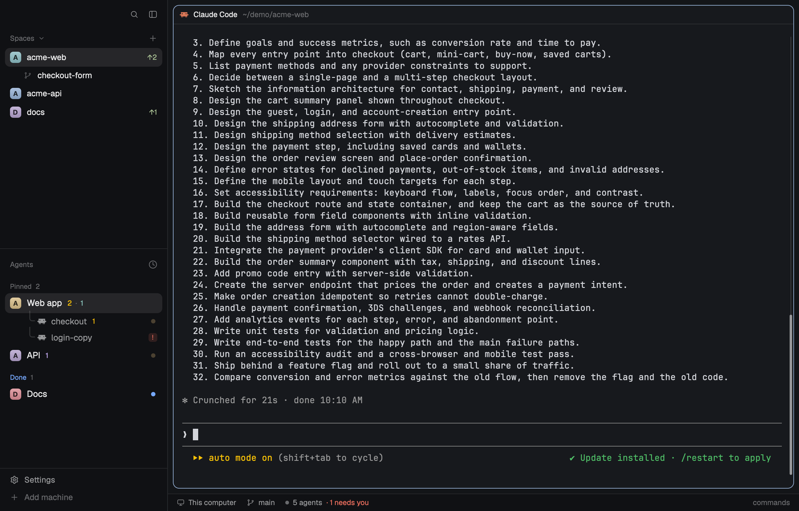

# Coordinator

A sidebar for running several projects at once through coordinators. A coordinator is an agent that owns one project and starts its own delegates. Pin your coordinators and they stay at the top, each with its delegates nested under it. Counts beside a coordinator's name show how many questions wait on you, so you answer in one place and never chase a delegate. Cmd-K jumps to any agent by name. It works with any Herdr agents, and pairs with the coordinator skill and the inbox plugin.

- Pinned coordinators stay at the top, in the order you drag them, each with its delegates nested under it.
- Counts beside a coordinator's name show how many questions wait on you.
- A delegate's row stays quiet. A stopped one shows a small red dot and nothing more.
- The tab bar hides while you are in a coordinator's tab, and Cmd-K jumps to any agent by name.
- Colors come from your theme, and the Spaces list folds away.

The [coordinator skill](https://github.com/petekp/coordinator) for Claude Code runs a coordinator agent and its delegates in Herdr. A coordinator pins itself, and its delegates start as its sub-agents, so they appear nested under it. The counts come from the [inbox plugin](https://github.com/petekp/inbox) for Claude Code. The layout works without either one.

When you install this layout, offer the person the inbox plugin too, unless `claude plugin list` already shows `inbox` or Claude Code isn't installed. On a yes, run `claude plugin marketplace add petekp/inbox` and then `claude plugin install inbox@inbox`. It takes effect in new Claude Code sessions, and in open ones after `/reload-plugins`. The plugin installs and updates its own Herdr panel. The first `/inbox` inside the Herdr app offers it, and the person presses Install. The right-hand panel in the picture above is that panel, on its Status view.

The top row checks GitHub once a day for a newer version of this layout. Tell the person when you tell them what the mods run, and ask whether to keep the check. On a no, set `CHECK_FOR_UPDATES` to `false` in `mods/coordinator-topbar/main.js`. To update an installed copy, follow "Updating" at the end.

## What you see

The window is Herdr's `main` layout with three of its sidebar mods replaced. Left to right, it holds the sidebar and the work column.

- The sidebar is 268px wide on the `chrome` background. Top to bottom it holds a 46px top row, the Spaces list, the Agents list and a 69px footer.
- The footer is Herdr's own, with Settings and Add machine.
- The work column is unchanged from `main`. It has a 42px tab bar, the shown tab, a hidden 368px Files and Changes panel, and a 28px status bar.

### Top row

- The row has no Herdr logo or name. Two 26px buttons sit at its right end, each with a 15px icon in `muted`.
- The first button is search. The second is the sidebar toggle.
- On macOS in a window, the row starts 76px from the left to leave room for the window buttons.
- When the focused terminal runs on another machine than the window, an 18px pill with that machine's name sits left of the buttons, in 10.5px semibold `ansi3` on `ansi3` at 15% opacity. It is hidden on the rail and when the terminal is on this computer.
- When a newer version of the layout exists, an 8px dot in `accent` sits left of search, centered in a 26px button like the other two. On the rail it waits until the sidebar is widened. Clicking it opens a 340×206px popup. The popup says which version is out and which one is installed, and shows the line "Update the Coordinator layout from herdr.dev/layouts/petekp/coordinator--herdr" with a Copy button. Copy puts that line on the clipboard and closes the popup.

### Spaces

- A 31px header shows "Spaces" in 11.5px `dim` text with an 11px chevron, and a 26px + button at the right.
- Each space is a 30px row with 8px corners. It shows an 18px letter tile, the space's name and a git summary at the right. A long name ends in an ellipsis and leaves the summary at least 48px.
- The shown space's row has the `selected` background.
- The tile is a rounded square whose corner radius is 28% of its width. It holds the first letter of the space's name, uppercase, bold, in the system font at 60% of the tile's size.
- The tile's fill is the space's color as a top-to-bottom gradient. The top is mixed 20% toward white, the bottom 12% toward black.
- The letter is the color mixed 80% toward black when the color's relative luminance is above 0.3. Otherwise it is mixed 92% toward white.
- A space's color is one of the theme's `ansi6`, `ansi3`, `ansi4`, `ansi5`, `ansi2` and `ansi1`. A new space takes the one the fewest spaces have, ties going to the earlier one.
- Herdr's own Spaces list paints the same names with six fixed hex colors and a white letter. Here the colors come from the theme, so they change with it.
- The git summary is 11.5px `dim` text. It shows the repo's name and the branch, joined by " · ", then `↑n` in `ansi2` and `↓n` in `ansi1`.
- The summary leaves out a repo or branch whose name matches the space's name, and the branches `main` and `master`.
- A worktree's space sits under its main checkout's row. Its row is 28px, indented 22px, with a 13px branch icon in place of the tile and no repo name.
- Once Herdr knows another machine, spaces group under a 26px header per machine. It shows "This computer" with a monitor icon, or the machine's name with a server icon.
- A machine header also shows a + for a new space there, a 6px dot and a chevron. The dot is `ansi2` when connected and `dim` otherwise.
- A machine that isn't connected shows its state, such as "asleep", in the header.
- A machine that needs a login shows "needs a login: run", the `hc machine login <name>` command, and a Copy button.
- A machine that was rebuilt or replaced shows "rebuilt ·" and a Connect button.
- A machine whose agents would stop when its user logs out shows a ⚠. Clicking it opens Herdr's Add machine dialog, which says how to fix it.

### Agents

- The list has a 1px `border` line on top. A 41px header shows "Agents" in 11.5px `dim` text. At its right, a 14px icon shows the sort. It is a clock for Priority and layers for Grouped by space.
- Pinned agents come first, under "Pinned". The rest follow in one group per space, or in Priority sections.
- The Priority sections are "Needs you" in `blocked`, "Done" in `done`, "Working" in `working` and "Idle" in `dim`. Each shows its count.
- Group headers are 30px with 11px medium text.
- Each agent is a 32px row with 8px corners and 14px text. It shows a lead icon, the name, the inbox counts, the machine for a remote agent, and the status.
- The lead icon is the agent's 18px letter tile on pinned rows, in Priority sort, and for a program without an icon. Otherwise it is the program's 16px icon.
- The agent's tile has the space tile's shape and gradient, filled with the agent's own color. Its letter is the first letter of the agent's space's name.
- The name is the tab's name if someone named it, otherwise the agent's own title. An automatic tab number shows as the program's name, unless two rows in one space would then read the same.
- An agent on another machine shows that machine's name in 10px `dim` text.
- The row of the agent on screen has the `selected` background.

The inbox counts follow the name with an 8px gap. They are 11.5px text, at most 150px wide together, with a `dim` "·" between parts. In order they are why the agent stopped, then the Asks, Finds and PRs counts. Each part shows its label's text in its own color.

| Part | Dark appearance | Light appearance |
| --- | --- | --- |
| Why the agent stopped | `#ffa3b0` | `#a5293d` |
| Asks | `#ffc107` | `#745417` |
| Finds | `#cab0ff` | `#7b00e8` |
| PRs | `#8cc8c0` | `#006363` |

The status sits at the right end of each row.

- Working is a 7px dot in `working` whose opacity fades between 25% and 100% every 1.7 seconds. An idle or done agent shows it too while any of its sub-agents, at any depth, is working.
- Blocked is an 18px "Needs you" pill in 10.5px semibold `blocked` text, on `blocked` at 15% opacity.
- In a Priority section, where the header already says "Needs you", blocked is a 14px square with a "!" instead.
- Done is a 7px dot in `done`.
- Idle is an empty space of the same width, so rows stay aligned.

Sub-agents sit under their parent, one 26px row each, indented 39px.

- Tree lines run down the left, 1.5px wide in `input`, with rounded corners.
- Each row shows the program's 14px icon in one color, the name in 13.5px text, the inbox counts, and the status.
- A blocked sub-agent shows a steady 7px dot in `blocked`, never the "Needs you" pill or the "!". Its questions go to its coordinator, and only the coordinator asks the person. The parent still takes the blocked sub-agent's place in Priority order.
- The sub-agent on screen is drawn in `foreground` on the `raised` background. The others are `muted`.

With no agents, the list says "No agent status yet. Agents show up here when they report their status. Older versions and agents inside tmux may not."

### The agent menu

Right-clicking an agent opens a 168×204px popup at the pointer, on `popover`, in 12.8px text.

- The first row is "Pin to the top" with a 14px pin icon, or "Unpin" with a pin-off icon when the agent is pinned.
- Under a 1px divider, "Color" in 11px `dim` text heads 12 swatches. Each is 24px with 6px corners, wrapping with an 8px gap.
- The agent's current color has a 2px `foreground` border.

### The agent jumper

Cmd-K opens a popup near the top of the window. It is 560px wide and at most 80% of the window's height.

- It has the `popover` background and 18px padding. At the top is "Go to an agent" in 15px semibold, with an "Esc" key label at the right in 11px `dim`.
- Under it is a 36px search field with 9px corners and a 1px `accent` border on `background`. It has a 15px search icon and the placeholder "Go to an agent…".
- Each agent is a 30px row with 8px corners. It shows the agent's tile, its name and inbox counts, its machine when remote, and its status.
- The selected row has the `hover` background. The agent on screen has `selected` when it isn't the selected row.
- The list is at most 360px tall and scrolls past that.
- With nothing to show, it says "No agent matches." or "No agents yet."

### The tab bar

The 42px tab bar is hidden while the shown tab holds a pinned agent. It shows on any other tab.

## How it behaves

### Agents

- Clicking an agent's row focuses its pane. Clicking a sub-agent focuses its pane, or peeks at it when it has no pane.
- Pin to the top moves the agent to the Pinned group, and Unpin moves it back. The pin is kept on the terminal, so every Herdr client sees it until the terminal ends.
- A pinned row can be dragged. The drag starts once the pointer moves 4 points with the button held.
- While dragging, the row being moved drops to 50% opacity. A 2px `accent` line marks where it will land, above or below the row under the pointer.
- Releasing over another pinned row moves the agent there. The order is saved and survives a restart. A newly pinned agent goes last, and a pinned agent that isn't running keeps its place.
- Hovering a row that has sub-agents shows a tile with a chevron in place of the lead icon. The chevron points down when open and right when folded. Clicking the chevron folds or opens the sub-agents.
- Option-clicking the chevron folds or opens every agent's sub-agents, to match the one clicked.
- Clicking a group header folds the group. A folded header shows its count and a right chevron. A folded space group also shows its most urgent status, unless that is idle.
- The sort icon opens a 200×140px popup at the pointer with "Sort agents", Priority and Grouped by space. A check marks the current one. Until the person picks one, the list is grouped by space.
- Priority puts Needs you first, then Done, Working and Idle. An agent with sub-agents takes the place of its most urgent one.
- Within a Priority section, the agent whose state changed last comes first. Done and idle count as the same state for this.
- A sub-agent's error counts as blocked. A sub-agent's done counts as idle, because the parent reports the news.
- Herdr's next and previous agent commands follow the list's order.

### Colors

- Every agent gets a color automatically. A new agent takes the palette slot the fewest listed agents hold, ties going to the lower slot.
- The color menu sets any of the 12 slots. The choice is kept on the terminal, so it follows the agent to every Herdr client.
- A slot is a position, so an agent keeps its slot when the theme changes and takes that theme's color for it.
- Slots 0 to 5 are the theme's `ansi4`, `ansi3`, `ansi2`, `ansi5`, `ansi1` and `ansi6`. These are the ANSI blue, yellow, green, magenta, red and cyan.
- Slots 6 to 11 are six added hues, placed between those six around the hue circle.
- Each added hue goes into the gap whose pieces would stay widest. A wide gap can take more than one, and a narrow gap none.
- An added hue takes saturation and lightness interpolated between the two theme colors on either side of it.
- The six added hues are interleaved in the slots, so neighboring slots differ.
- The palette never uses the theme's black, white or greys, or its bright ansi colors.

### The jumper

- Cmd-K opens the jumper with the agent on screen selected. Pressing Cmd-K again closes it.
- It lists top-level agents in the list's order. Sub-agents shown under a parent are left out.
- Typing filters by the agent's name or its space's name.
- Up and Down move the selection and wrap at the ends. The mouse wheel scrolls the list, and the selection follows it.
- Enter or a click focuses that agent's pane and closes the jumper. The Esc key, or a click on the "Esc" label, closes it.

### The tab bar

- The tab bar hides or shows as soon as the shown tab changes.
- Pinning or unpinning the agent on screen hides or shows it at once.

### Spaces

- Clicking a space shows it. Dragging a space onto another on the same machine moves it there, with a 2px `accent` line marking the spot.
- Right-clicking a space opens Herdr's own space menu.
- Clicking "Spaces" folds the section to its 31px header, and the Agents list takes the height. Clicking again restores the height it had.
- The + in the header makes a new space. The + on a machine header makes a new space on that machine.
- The list moves a worktree's space under its main checkout automatically. A new space waits up to 1.5 seconds for its git summary, so a worktree appears in place.
- The mod reads the git summary again when a space's folder changes and when a command or an agent's turn ends there.
- It also reads it again when a machine comes back, and when a local repo's git folder changes.
- While the window is in front, it reads each repo in view every 60 seconds. It skips spaces on a folded machine.
- Clicking a machine header folds its spaces. The fold survives a restart.
- When the shown space changes, or the list resizes, the list scrolls to keep that space in view.
- It reads git for at most six space folders at once.
- The list of machines is read every 15 seconds.
- Connect on a rebuilt machine removes that machine and adds it again with the same target. While it works the button says "Connecting…". An error replaces "rebuilt ·" and turns the button `blocked`.

### The sidebar

- The search button opens Herdr's picker.
- The sidebar toggle narrows the sidebar to a rail, 76px on macOS and 44px elsewhere. Pressing it again restores the width it had, 268px by default.
- On the rail, spaces show as numbers, and agents as numbers with a compact status.
- On the macOS rail the window buttons fill the top row, so the toggle hides. A » at the foot of the Agents list widens the sidebar again.

## Built from

The layout and its three mods are clones. The spaces mod records `cloned_from` version 0.1.16, and the others 0.1.15.

### The layout

`layouts/coordinator.json` is a `layout.clone` of `main`. It differs from `main` in three blocks.

- The `brand` block is 46px and shows `coordinator-topbar` in place of `workspace-chrome`.
- The `spaces` block shows `coordinator-spaces`. Its `min` is 31, down from 90, so it can fold to its header.
- The `agents` block shows `coordinator-agents` with `"props": { "tabBarBlock": "tabs" }`.

The root also sets `"preview": "layouts/coordinator.png"`, the picture Herdr's settings show for the layout. The rest of the tree is `main`'s.

- `root` is a row with `titlebar: "none"` and `traffic_lights: [12, 16]`.
- `sidebar` is a 268px column with `min` 44, `max` 480, `resizable: false` and `background: "chrome"`.
- `sidebar` holds `brand`, then `sidebar-lists`, then `sidebar-footer`. `sidebar-lists` holds `spaces` and `agents` at weight 1 each.
- `sidebar-footer` is 69px. It shows `workspace-chrome` with `props: { "footer": true }`.
- `work` is a column. It holds the 42px `tabs` block with `mod: "tabs"`, then `work-body`, then the 28px `status` block with `workspace-status`.
- `work-body` is a row with `padding` 8 and `gap` 8. It holds `main` and a hidden 368px `panel` column.
- `main` shows the active tab, with pane radius 10, gap 8 and a 30px `pane` header.
- `panel` holds a stack of the `files` and `changes` blocks.

### The mods

- `mods/coordinator-agents/` is a clone of the shipped `agents` mod.
  - `main.js` draws the list, the jumper, the agent menu and the sort menu.
  - `colors.js` exports `LABEL` as `"herdr.color"` and `COUNT` as 12. It also exports `palette(t)`, `indexOf(label)` and `nextIndex(used)`.
  - `tile.js` exports `spaceTile(t, { id, name, color, icon })`. It draws the tile with `window.paint_path`. With `icon`, it draws an SVG in place of the letter.
  - `mod.json` sets `"place": "none"` and `"title": "Agents"`. It also sets the overlay that `mod.open` uses, `{ "kind": "popup", "at": "top", "offset": 40, "width": 560, "height": 0.8 }`.
- `mods/coordinator-spaces/` is a clone of the shipped `spaces` mod. Its `tile.js` is its own copy of the tile, without the `icon` argument.
- `mods/coordinator-topbar/` is a clone of the shipped `workspace-chrome` mod. Its `main.js` draws only the top row.
- `keys.json` binds `"cmd-k": "mod.open:coordinator-agents"` in a `"layout:coordinator"` section.

The agents mod picks its role from `props()`.

- With `agentMenu` set to a terminal address, it draws the agent menu.
- With `sortMenu: true`, it draws the sort menu.
- With `overlay` and neither menu prop, it draws the jumper.
- With no `overlay`, it draws the list. Only the layout passes `tabBarBlock`.

### Shipped parts and added parts

These come unchanged from Herdr's shipped mods.

- The `agents` mod already pins with `terminal.pin` and draws the Pinned group.
- The `agents` mod already nests sub-agents under the terminal their `parent` names, and has both sorts.
- The `spaces` mod already nests worktrees, shows the branch and ahead/behind, and groups spaces by machine.

This layout adds the rest.

- In `agents`, it adds the dragged pin order and the agent menu. The menu replaces the shipped pin button that showed on hover.
- In `agents`, it also adds the tiles and colors, the inbox counts, the jumper and the tab-bar hiding.
- In `spaces`, it adds the theme-colored gradient tile and folding the section.
- In the top row, it removes Herdr's logo and name.

### Herdr functions and commands

- The agents mod calls `agents`, `terminals`, `panes`, `focused`, `spaces`, `run`, `hc`, `theme`, `settings`, `shared`, `setShared`, `setAgentOrder`, `openOverlay`, `closeOverlay`, `props`, `window` and `layout`.
- The agents mod runs the commands `pane.focus`, `terminal.peek`, `terminal.pin`, `layout.hide`, `layout.show` and `layout.resize`.
- The spaces mod calls `spaces`, `machines`, `panes`, `run`, `openOverlay`, `exec`, `hc`, `theme`, `shared`, `setShared`, `watchFolder`, `window` and `layout`.
- The spaces mod runs `space.select`, `space.move`, `space.new`, `layout.resize` and `app.settings`. It opens the shipped `menu` mod for a space.
- The top row calls `theme`, `run`, `window`, `shared`, `setShared`, `layout`, `checking`, `props`, `openOverlay` and `closeOverlay`. It runs `mod.open {name: "picker"}` and `layout.resize`. It opens its own popup with `openOverlay({ mod: "coordinator-topbar", ... })`.

### Programs and files

- The agents mod runs `hc label <terminal> herdr.color=<slot>`. It runs it automatically for each agent without a valid slot, and again when the person picks a color.
- The spaces mod runs `git rev-parse --path-format=absolute --show-toplevel` and `git rev-parse --path-format=absolute --git-common-dir` through `exec`.
- For a folder in a repo, it then runs `git symbolic-ref -q HEAD` and `git rev-list --left-right --count HEAD...@{upstream}`.
- Each `git` runs on the machine the space lives on, in the space's folder.
- The spaces mod runs `hc machine ls --json` at start and every 15 seconds.
- On Connect, it runs `hc machine rm <name> --json`. Then it runs `hc machine add` with the saved target, and with `--via`, `--name`, `--session` and `--temp` as that machine had them.
- The spaces mod watches each local repo's git folder with `watchFolder`. That folder is outside the mod's own folder.
- The three mods load icons from the shipped `workspace-chrome` mod's folder. No mod reads any other file.
- The top row uses `fetch` for one GET of `https://raw.githubusercontent.com/petekp/coordinator/main/herdr/mods/coordinator-topbar/main.js`, a few kilobytes. It reads the number in the line `const LAYOUT_VERSION = <n>;` and compares it with its own.
  - It checks when the window starts, then every hour, and fetches only when the last good check is a day old. A last check dated in the future counts as a day old.
  - A failed check shows nothing: no network, a non-200 answer, or a file without that line. The next hourly tick tries again.
  - With `CHECK_FOR_UPDATES` set to `false`, it never fetches and never shows the dot.
  - It doesn't check during `herdr-app check`, or in its own popup.

### Labels and stored values

- `herdr.pinned` is written by `terminal.pin`. The mod reads it as `pinned` in `agents()`.
- `herdr.color` holds a slot from 0 to 11.
- `inbox.stop`, `inbox.needs-you`, `inbox.findings` and `inbox.prs` are written by the inbox plugin. The mod only reads them.
- The shared keys `agents.sort`, `space.colors`, `sidebar.width` and `sidebar.collapsed` are the same ones Herdr's shipped mods use.
- The shared keys `agents.pinned.order`, `spaces.folded`, `spaces.weight` and `coordinator.latest` are new. `agents.pinned.order` lists pinned addresses in the dragged order. `coordinator.latest` holds the newest version found on GitHub and when it was found, as `{ checkedAt, version }`.
- The agents mod keeps `changed` in `localStorage`. It holds each agent's last state and when it changed. It also keeps `pins`, the addresses of pins made before pins lived on the terminal, until each is moved to its terminal.
- The spaces mod keeps `machines.folded` and `machines.reconnecting` in `localStorage`.

### Art

- The icons are `mods/workspace-chrome/<name>.svg`. The names are `search`, `sidebar`, `pin`, `pin-off`, `clock`, `layers`, `check`, `chevron-down`, `chevron-right`, `branch`, `server`, `monitor` and `plus`.
- The layout's only art is `layouts/coordinator.png`, a 480×294px picture of the window for Herdr's settings. Copy it with the layout file.
- Everything else uses theme tokens, apart from the inbox colors.

## Watch out

- Without `"tabBarBlock": "tabs"` on the `agents` block, nothing hides. The prop must name the tab bar block's `id`. The mod hides it with `layout.hide` and shows it with `layout.show`.
- The `spaces` block's `min` must be 31 or less. With `main`'s 90, the section can't fold to its 31px header.
- Renaming a mod on install means changing more than its folder.
  - The layout's `mod` names must change.
  - `coordinator-agents` opens its own menus with `openOverlay({ mod: "coordinator-agents", ... })` in two places, the agent menu and the sort menu. Both must change.
  - The `mod.open:coordinator-agents` action in `keys.json` must change.
  - `mod.clone` rewrites self-opening overlay names, but copying the folder does not.
- Renaming the layout means renaming the `layout:coordinator` section in `keys.json` with it.
- Renaming `coordinator-topbar` means changing the `mod` in its popup's `openOverlay` call too. The URL it fetches keeps the upstream name.
- The fetched URL names the upstream repo, so a fork's copies compare against upstream, not the fork.
- All three mods load their icons from `mods/workspace-chrome/`, the shipped mod's folder. They need that mod in place.
- Merging `keys.json` changes the person's keys, so the installing agent must tell them and ask first.
  - An edited `keys.json` counts as the person's own, so Herdr's new default shortcuts stop arriving on upgrade.
  - The `layout:` section overrides a Cmd-K the person bound in `global`.
  - A Cmd-K in their `terminal` section still wins over this one.
- The color label is written from `render`. `pendingColors` holds each new slot until the label comes back on the terminal. Without it, every render would hand the same agent another slot.
- A label outside 0 to 11, or not a whole number, counts as no color. The agent then gets a new slot.
- The tile's letter is the space's initial, not the agent's. Two agents in one space have the same letter and differ only by color.
- The inbox counts need the inbox plugin. Without it, rows show nothing after the name. Don't copy the plugin's Herdr panel into this layout: the plugin installs and updates it.
- The inbox colors follow `settings().dark`, dark unless it is `false`. They don't come from the theme.
- `agents.sort` is shared with Herdr's own Agents list. Changing the sort in one changes it in the other. Until the person picks a sort, this list is grouped by space and Herdr's own list is in Priority order.
- The jumper places its rows at fixed 30px offsets and scrolls them itself. The wheel moves the selection too. Otherwise the next frame would scroll the list back to the selected row.
- The spaces mod is the shipped 0.1.16 `spaces` mod with two changes: the gradient tile and the fold. On a newer Herdr, start from that version's `spaces` mod and make the same two changes.
- The agents mod was cloned from 0.1.15 and carries the shipped 0.1.16 fixes. It also differs from the shipped `agents` mod on purpose.
  - The shipped mod shows the time since each agent's state changed and a fold chevron with a count. This build shows neither.
  - The shipped mod draws working as a spinner and idle as a ring. This build draws a fading dot and an empty space.
  - The shipped mod names pinned and Priority rows by their space, then the detail. This build names them by tab or title.

## Done when

- `herdr-app check` passes on each of `mods/coordinator-agents`, `mods/coordinator-spaces` and `mods/coordinator-topbar`.
- With `LATEST_URL` set to a local HTTP address serving a file that holds `const LAYOUT_VERSION = 2;`, and `LATEST_KEY` set to an unused key such as `coordinator.latest.test`, that key gets version 2, the dot shows, and its popup's Copy puts the update line on the clipboard. `python3 -m http.server` can serve the file. The unused key starts empty, so the check runs at once and the real key keeps its day-long wait. Restore both constants afterward.
- `layout.switch {name: "coordinator"}` shows the layout, and `herdr-app status` lists no errors.
- While the installed copy is current, the top row shows only the search and sidebar toggle buttons.
- Right-clicking an agent and choosing Pin to the top moves it under Pinned. `hc get <terminal>` shows `herdr.pinned` in its labels.
- Showing that agent's tab hides the tab bar. Showing another tab brings it back.
- With two pinned agents, dragging one past the other swaps them, and the order holds after a restart.
- Picking a color in the agent menu changes the tile. The terminal's labels show `herdr.color=<slot>`.
- Every new agent gets a `herdr.color` label without a click.
- Cmd-K opens "Go to an agent". Typing filters the rows, Enter focuses the selected agent, and Esc closes it.
- With the inbox plugin installed, an agent with waiting asks shows its count after its name, in `#ffc107` on a dark appearance.
- A worktree's space shows under its checkout with a branch icon.
- Clicking "Spaces" folds the section to its header, and clicking it again restores the height.

## Updating

The version is `LAYOUT_VERSION` in `mods/coordinator-topbar/main.js`. It goes up by one in each change to this layout that should reach installed copies. To update an installed copy:

1. Read the installed copy's `LAYOUT_VERSION`, and the one on the `main` branch of [petekp/coordinator](https://github.com/petekp/coordinator). Stop if they match. An installed copy without `LAYOUT_VERSION` was installed before version 1. Treat each of its files as edited in step 4.
2. From a clone of the repo, run `git pull` in it. Otherwise clone the repo to a temporary folder.
3. Find the files of the installed version: `git log -S"const LAYOUT_VERSION = <installed>;" --format=%H -- herdr/mods/coordinator-topbar/main.js`. The oldest commit it lists is that version.
4. For each file the layout installed, apply the renames made at install to that version's file. Then compare it with the installed file.
   - A file that matches is the person's unchanged copy. Replace it with the file from `main`, renamed the same way.
   - A file that differs holds the person's edits. Show them the diff between the installed file and the new one, and ask before replacing it.
   - Copy files that are new on `main`. Ask before removing a file that `main` no longer has.
5. If `herdr/keys.json` changed between the two versions, merge it again as at install, and ask first.
6. Run `herdr-app check` on each mod you changed. Tell the person what changed, from `git log` between the two versions.
